<h2 align="center">🧑‍💻 About Me</h2>

  

  I build web, desktop and mobile applications, integrate APIs, and automate everyday workflows. 
  My projects span point-of-sale systems, messaging bots, transit apps and an educational compiler.

  Application development · Databases · Linux servers · Automation · IoT concepts

---

<h2 align="center">⚙️ Languages &amp; Tools</h2>

<h4 align="center">Languages &amp; Markup</h4>

  &nbsp;&nbsp;
  &nbsp;&nbsp;
  &nbsp;&nbsp;
  &nbsp;&nbsp;
  &nbsp;&nbsp;
  
    
  &nbsp;&nbsp;
  &nbsp;&nbsp;
  &nbsp;&nbsp;
  &nbsp;&nbsp;
  &nbsp;&nbsp;
  

<h4 align="center">Frameworks &amp; APIs</h4>

  &nbsp;&nbsp;
  &nbsp;&nbsp;
  &nbsp;&nbsp;
  &nbsp;&nbsp;
  

  &nbsp;
  

<h4 align="center">Mobile &amp; Desktop</h4>

  &nbsp;&nbsp;
  &nbsp;&nbsp;
  &nbsp;&nbsp;
  

<h4 align="center">Databases &amp; Backend Services</h4>

  &nbsp;&nbsp;
  &nbsp;&nbsp;
  &nbsp;&nbsp;
  &nbsp;&nbsp;
  &nbsp;&nbsp;
  &nbsp;&nbsp;
  

<h4 align="center">Development Tools</h4>

  &nbsp;&nbsp;
  &nbsp;&nbsp;
  &nbsp;&nbsp;
  &nbsp;&nbsp;
  &nbsp;&nbsp;
  &nbsp;&nbsp;
  

<h4 align="center">Systems, Hardware &amp; Graphics</h4>

  &nbsp;&nbsp;
  &nbsp;&nbsp;
  &nbsp;&nbsp;
  &nbsp;&nbsp;
  &nbsp;&nbsp;
  &nbsp;&nbsp;
  &nbsp;&nbsp;
  

---

<h2 align="center">🚀 Projects &amp; Work</h2>

<h4 align="center">🛒 Multi-store Point of Sale</h4>

  Desktop and mobile apps for sales, inventory, cash registers and stock transfers, 
  connected through a shared API and integrations with a central system. 
  React · Electron · React Native · Expo · Node.js · Express · PostgreSQL

<h4 align="center">🚌 VictoriaTransit</h4>

  Companion apps for drivers and passengers, with location sharing and map views. 
  TypeScript · React Native · Expo · Firebase · Geolocation

<h4 align="center">🚗 Yancuic T-Box — Concept &amp; Architecture</h4>

  A vehicle telematics proposal for Olinia, covering GNSS, CAN bus and edge processing, 
  with interfaces for vehicle owners and the manufacturer. 
  IoT · Raspberry Pi · GNSS · CAN Bus · React Native · Node.js · PostgreSQL

---

<h2 align="center">🏅 Badges</h2>

  

  <a href="https://www.credly.com/badges/212f6d03-8c8c-4eaf-9301-d49c91cad0ab/public_url">View credential on Credly ↗</a>

